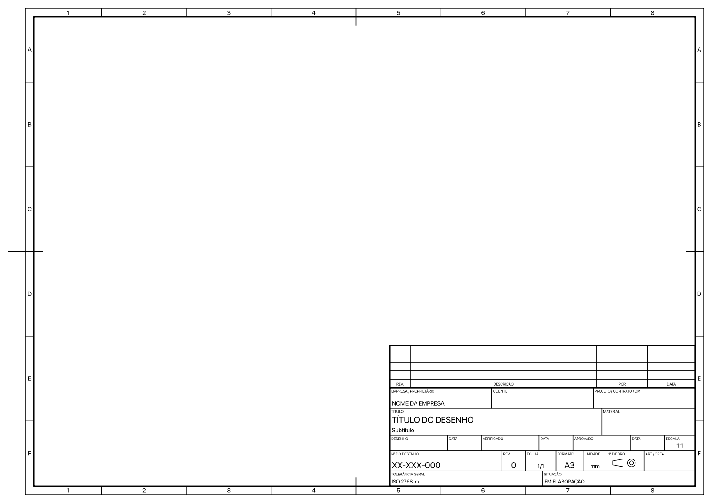

# Modelos ABNT para TechDraw (FreeCAD)

Folhas de desenho técnico no padrão brasileiro para a bancada **TechDraw** do FreeCAD, com legenda e quadro de revisões em português do Brasil.



## Formatos

| Arquivo | Formato | Dimensões (mm) |
|---|---|---|
| `A0_Paisagem_ABNT_NBR16752.svg` | A0 paisagem | 1189 x 841 |
| `A1_Paisagem_ABNT_NBR16752.svg` | A1 paisagem | 841 x 594 |
| `A2_Paisagem_ABNT_NBR16752.svg` | A2 paisagem | 594 x 420 |
| `A3_Paisagem_ABNT_NBR16752.svg` | A3 paisagem | 420 x 297 |
| `A4_Retrato_ABNT_NBR16752.svg` | A4 retrato | 210 x 297 |

## O que cada folha tem

- Moldura com margem de 20 mm à esquerda (arquivamento) e 10 mm nas demais, conforme a ABNT NBR 16752, alinhada à ISO 5457.
- Marcas de centro e, do A3 ao A0, referência por zonas a cada 50 mm (números e letras, sem I e O).
- Legenda de 180 mm de largura no canto inferior direito, alinhada à ISO 7200, com os campos:
  empresa / proprietário, cliente, projeto / contrato / OM, título e subtítulo, material,
  desenho, verificado e aprovado (cada um com data), escala, nº do desenho, revisão, folha,
  formato, unidade, símbolo de 1º diedro, ART / CREA, tolerância geral e situação.
- Quadro de revisões com 4 linhas (rev., descrição, por, data) logo acima da legenda.

Todos os campos são editáveis no TechDraw (clique duas vezes no texto da folha). Empresa, título, desenhista, data, escala e folha são preenchidos automaticamente pelo FreeCAD quando essas informações existem no documento.

## Instalação

**Pelo Addon Manager:** procure por "ABNT" e instale.

**Manual:** copie esta pasta para a pasta `Mod` do FreeCAD:

- macOS: `~/Library/Application Support/FreeCAD/<versão>/Mod/`
- Windows: `%APPDATA%\FreeCAD\<versão>\Mod\`
- Linux: `~/.local/share/FreeCAD/<versão>/Mod/`

## Uso

1. Na bancada TechDraw, use **Nova página a partir de modelo**.
2. Navegue até a pasta `Mod/FreeCAD-Templates-ABNT/Templates` e escolha o formato.
3. Para usar sempre, em **Editar > Preferências > TechDraw**, aponte o **Diretório de modelos** para essa pasta e, se quiser, escolha uma das folhas como **Modelo padrão**.

A fonte usada é a `osifont`, que já acompanha o FreeCAD.

## Regerar ou ajustar

As folhas são geradas pelo script `gerar.py` (Python 3, sem dependências). Para mudar campos, larguras ou textos, edite o script e rode:

```
python3 gerar.py
```

## Observação

As folhas seguem a estrutura da ABNT NBR 16752 e das normas ISO correspondentes. Antes de usar em contrato, confira os campos exigidos pelo seu cliente ou pela norma interna da empresa (por exemplo, normas Petrobras) e ajuste pelo `gerar.py` se precisar.

## Licença

CC0 1.0: domínio público. Use, modifique e distribua à vontade.

---

## English

Drawing sheet templates for FreeCAD TechDraw following the Brazilian ABNT NBR 16752 standard (aligned with ISO 5457 / ISO 7200), sizes A0 to A4, with a Brazilian Portuguese title block and a revision table. All fields are editable; several are auto-filled by FreeCAD. Licensed CC0 1.0.
